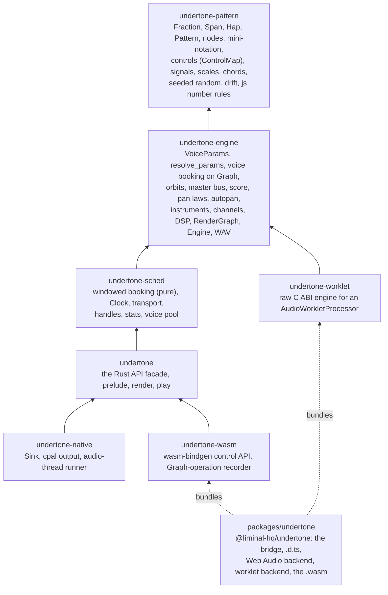
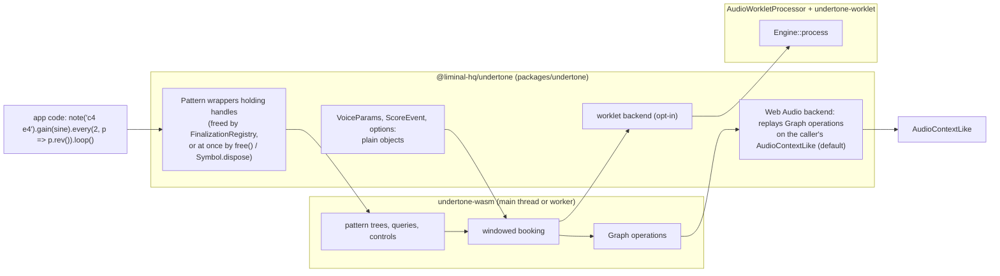

# Architecture of the Rust-first Undertone

The target layout of this repository, the rules between its crates, how the npm package is built from WebAssembly, how the TypeScript and the Rust live side by side until the TypeScript retires, CI, versioning and releases, the site, the path with its rollbacks, and how other projects depend on it.

## Workspace layout

Option A (D-15): a root Cargo workspace beside the existing TypeScript. During the migration (from RF-03 to RF-32):

```text
undertone/
  Cargo.toml                    # the workspace (RF-03)
  Cargo.lock
  rust-toolchain.toml           # pinned Rust (the lab uses 1.98.0)
  rustfmt.toml  deny.toml       # hard tabs; permissive licences only
  LICENSE  LICENSE-MIT  LICENSE-APACHE   # the existing MIT file; the crates are MIT OR Apache-2.0 (D-03)
  crates/
    undertone-pattern/          # new, empty at RF-03, grown in RF-07 and RF-13 to RF-17
    undertone-engine/           # new, empty at RF-03, grown in RF-18 to RF-21
    undertone-sched/            # new (RF-22)
    undertone/                  # new: the Rust API facade (RF-23): prelude, Error, Player, render, examples, corpus runner
    undertone-wasm/             # new: the real WASM Undertone, the full Rust API through wasm-bindgen (RF-24)
    undertone-native/           # new: cpal output (RF-28)
    undertone-worklet/          # new: raw-ABI engine for an AudioWorklet (RF-29)
  packages/
    undertone/                  # new: the JavaScript bridge, published as @liminal-hq/undertone (RF-25)
      src/  test/  wasm/        # wasm/ is build output, gitignored
  conformance/
    README.md                   # the corpus format (RF-05)
    recorder/                   # TypeScript: runs the reference and writes cases
    cases/                      # the corpus, committed, generated from the reference
    api/                        # the API report and the VoiceParams field list (RF-06, RF-14)
    test-classes.json           # R5's classification (RF-12)
  src/                          # the TypeScript reference (merged #39, #42, #44; never released), unchanged; deleted in RF-32
  docs/                         # the VitePress site and playground, as today (RF-31 moves it onto the bridge)
    rust-migration/             # this plan (excluded from the published site by srcExclude)
  scripts/                      # check-layering.sh, build-wasm.sh
  package.json                  # until RF-32: the TypeScript package (version 0.3.0, unreleased changes on main); after: the private workspace root
```

After RF-32 the same, without `src/`, and with the root `package.json` private. `target/` is ignored by Git, Prettier, and ESLint from RF-03.

**Why `src/` and `docs/` stay where they are** (D-15): moving the TypeScript to `reference/ts/` and the site to `site/` would break the Pages workflow, every link into the docs, and the playground's imports, for no gain, since `src/` is deleted at RF-32 anyway. The site stays `docs/`.

## Crates and their dependency rules



Arrows point from a crate to what it depends on.

| Crate               | May depend on (workspace) | Notes                                                                                 |
| ------------------- | ------------------------- | ------------------------------------------------------------------------------------- |
| `undertone-pattern` | nothing                   | `no_std` + `alloc` if R1 shows it is cheap (D-18); no `serde` in its default features |
| `undertone-engine`  | `undertone-pattern`       | `no_std` + `alloc` with a `libm` feature as R9 decides; `serde` for `VoiceParams`     |
| `undertone-sched`   | pattern, engine           | `std`                                                                                 |
| `undertone`         | pattern, engine, sched    | `std`; the crate Rust users depend on                                                 |
| `undertone-native`  | `undertone`               | `cpal`; `publish` per D-10                                                            |
| `undertone-wasm`    | `undertone`               | `wasm-bindgen` pinned exactly; `publish = false` (it ships inside the npm package)    |
| `undertone-worklet` | pattern, engine           | raw ABI, no `wasm-bindgen`; `publish = false`                                         |

**Prior art, not a dependency.** The lab (`liminal-hq-labs/undertone-sound`) has two crates that did similar work: `undertone-mini` (exact `i128` fractions, a node-tree `Pattern`, the whole mini-notation, the JavaScript number rules) and `undertone-dsp` (every 0.3.0 `VoiceParams` field, voice booking on a `Graph` trait, orbits, the master bus, `score()`, an in-house renderer). Nothing from them is copied, imported, or depended on: `undertone-pattern` and `undertone-engine` are written here from the TypeScript reference and the corpus (D-05). They may be read for design ideas, and run once as a cross-check outside the repository, with the result noted in a spike report.

**Naming: two crates called `undertone-wasm`.** The lab's `undertone-wasm` is the lab's **demo bindings** (the oplstream OPX importer and player through oplon, plus a `ScorePlayer` and `renderVoice` for its demo page), not Undertone's WebAssembly core. The real WASM Undertone is this repository's `undertone-wasm` (RF-24). The lab may rename its own crate (for example `undertone-sound-wasm`) on its own schedule; nothing here depends on it.

**Conventions for every crate:** edition 2024, `unsafe_code = "forbid"` (a test-only counting allocator is the one exception, behind `#[cfg(test)]`, named in `AGENTS.md`), `missing_docs = "warn"` (and `cargo doc` with `-D warnings` in CI), Clippy clean with `-D warnings`, permissive licences only (`cargo deny`), hard tabs through the root `rustfmt.toml`. The root `Cargo.toml` declares these once in `[workspace.lints]` and every crate opts in with `lints.workspace = true`. New `.rs` files carry the header from `AGENTS.md` with the SPDX identifier `MIT OR Apache-2.0` (D-03).

**Rules, enforced by `scripts/check-layering.sh` (RF-04):** the graph above is the whole graph; no crate depends on anything outside crates.io (no git or path dependency on the lab or the studio, ever); the lab and the studio depend on this repository, never the reverse.

**Two seams** carry the engine to its outputs:

- **`Graph`** (in `undertone-engine`): the operations a voice is booked with (`node`, `automate`, `connect`, `start`, `stop`, `buffer`, `periodic_wave`). Implemented by `LogGraph` (the recorder the corpus uses), `RenderGraph` (the in-house renderer), and the operation recorder in `undertone-wasm` that the bridge replays onto a Web Audio context. So in the browser's default backend, `Graph` **is** the output path (the planner's position).
- **`Sink`** (in `undertone-native`, after `Engine`): where rendered frames go: a `cpal` stream, a WAV writer, a test buffer.

An event-level `Synth` trait for other backends (OPL chips, MIDI) is the lab's concern and is designed there against `undertone`'s resolved voices; nothing in this repository knows about OPL.

## The npm package built from WebAssembly



- **Build:** `scripts/build-wasm.sh` (RF-24) checks the `wasm-bindgen` CLI against the crate's pin, runs `cargo build --release --target wasm32-unknown-unknown -p undertone-wasm` (and `-p undertone-worklet`), `wasm-bindgen --target web --weak-refs --out-dir packages/undertone/wasm/`, and `wasm-opt -Oz`. Then `tsc` (or `bun build` plus `tsc --emitDeclarationOnly`) builds the bridge into `packages/undertone/dist/`. The published tarball holds `dist/` (JavaScript and `.d.ts`) and the two `.wasm` files.
- **Loading:** the entry instantiates the control module with top-level `await` (D-17, open: R3 measured it, see [R3.md](results/R3.md)), so `import { note } from '@liminal-hq/undertone'` is usable at once as today. The package's `exports` sends the `node` condition (Node, Bun, Deno) to a synchronous entry that reads the module from disk, and every other condition to the browser entry. Vite 5's default build target refuses top-level `await` (`build.target: 'esnext'` fixes it), and a `./init` subpath with an explicit `init()` is the escape hatch. The worklet module is compiled on the main thread and posted to the processor as a `WebAssembly.Module`.
- **Querying off the main thread (RF-16):** a tree of data nodes, signals included, serialises to a short text (`Pattern::serialize`, [RF-16.md](results/RF-16.md)) that rebuilds, on another thread, a tree that answers every query and sample exactly as the original does (checked on 120 corpus signal trees and 217 chord, drift, and notes trees, 1,000 windows each). So RF-29's worklet, or a worker, can query patterns off the main thread whenever the tree has no foreign leaf. A `Custom` node (a Rust closure) and a `Foreign` node (a JavaScript callback behind the bridge, such as `signal(fn)`, `fmap(fn)`, or `new Pattern(query)`) cannot cross threads: `serialize` refuses them with an error that names the node, and the worklet backend reports that error as its diagnostic.
- **Types:** the bridge's `.d.ts` is hand-written TypeScript (the 0.4.0 names), with data types (`VoiceParams`, `ScoreEvent`, options) generated by `ts-rs` from the Rust structs and checked against the API report (RF-06).
- **Size budgets:** control module at most 150 KB, worklet module at most 200 KB, after Brotli (D-07); a failing CI check.
- **Runtimes:** see D-08 (default: Chromium and Edge 89+, Firefox 89+, Safari 15+, Node 20+, Bun 1.2+, Deno 1.x current).

## The TypeScript and the Rust side by side (RF-01 to RF-32)

- **`src/` is the frozen reference at `452f782`** (the merge of #44 on `main`, D-01). It takes no features. A bug found in it is fixed only if the fix is needed to make the reference right, and then it gets a corpus case. It is never published: the TypeScript 0.4.0 does not exist on npm. A user-facing 0.3.x patch happens only if the person asks (from a `release/0.3.x` branch cut from `v0.3.0`).
- **Its tests keep running** in CI (`bun run test`) until RF-32, so the reference stays trustworthy while the corpus is generated from it.
- **The corpus is the contract** between them and **the only oracle**: generated from `src/` by `conformance/recorder/`, committed, checked in CI against the reference (`conformance:check`), against Rust (`cargo nextest`), and from RF-27 against the package (Vitest).
- **The TypeScript tests move to the bridge** in RF-27 (public API and Web Audio classes, unchanged except their imports); internal tests are replaced by Rust tests named in `conformance/test-classes.json`.
- **At RF-32** `src/` is deleted; the recorder then takes a checkout of the reference SHA (`scripts/reference-worktree.sh` makes a worktree of it), so the corpus can still be regenerated after the source is gone.
- **Tooling:** Bun stays the JavaScript package manager and Vitest the test runner; ESLint and Prettier cover `packages/`, `conformance/`, and `docs/`; `cargo fmt` and Clippy cover `crates/`. `.prettierignore` and the ESLint ignores gain `target`.

## CI

One job per check, as today (`.github/workflows/ci.yml`), with the summary step each job already writes. The Rust jobs run in the shared `ghcr.io/liminal-hq/ci-rust` image from `liminal-hq/.github`, which is public and pinned by digest (the recommended pin is in that repository's `docs/reference/recommended-image-pins.md`). It provides Rust 1.98.0, rustfmt, Clippy, `cargo-nextest`, `cargo-deny`, `git`, and `jq`; the wasm job adds the `wasm32-unknown-unknown` target with `rustup`. The TypeScript jobs run in the shared `ghcr.io/liminal-hq/ci-web` image (Node 24, pnpm, Bun 1.4.4), also pinned by digest, instead of `oven-sh/setup-bun`.

| Job                                | Command                                                                                                             | From                                               |
| ---------------------------------- | ------------------------------------------------------------------------------------------------------------------- | -------------------------------------------------- |
| Build, Test, Lint, Format, Docs    | as today                                                                                                            | now; Build and Test switch to the package at RF-32 |
| Rust format                        | `cargo fmt --all -- --check`                                                                                        | RF-04                                              |
| Rust Clippy                        | `cargo clippy --workspace --all-targets --locked -- -D warnings`                                                    | RF-04                                              |
| Rust tests                         | `cargo nextest run --workspace --locked`                                                                            | RF-04                                              |
| Rust doc tests and docs            | `cargo test --doc`; `cargo doc --no-deps` with `RUSTDOCFLAGS=-D warnings`                                           | RF-04                                              |
| Dependency licences and advisories | `cargo deny check`                                                                                                  | RF-04                                              |
| Crate layering                     | `scripts/check-layering.sh`                                                                                         | RF-04                                              |
| WebAssembly build                  | `cargo build --target wasm32-unknown-unknown` of the engine crates; from RF-24 `scripts/build-wasm.sh`              | RF-04, RF-24                                       |
| `no_std` check                     | `cargo build -p undertone-pattern -p undertone-engine --no-default-features --target thumbv7em-none-eabi` (if D-18) | RF-13                                              |
| WASI build                         | `cargo build --target wasm32-wasip1 -p undertone`                                                                   | RF-30                                              |
| Conformance (reference)            | `bun run conformance:check`                                                                                         | RF-05                                              |
| API report                         | `bun run api:check`                                                                                                 | RF-06                                              |
| Size budgets                       | a script reading the Brotli sizes of the built modules                                                              | RF-24                                              |
| Bridge tests                       | `bun run --cwd packages/undertone test` (Vitest: the moved suite and the corpus runner)                             | RF-25, RF-27                                       |

If RF-04 measures a warm pull-request run over 10 minutes, the Rust jobs run only when `crates/`, `conformance/`, `packages/`, or `Cargo.*` change, and a nightly workflow runs everything.

## Versioning and the release flow

- **One version** for the npm package and every published crate, bumped together on `chore/release-v<version>`, as the repository does today.
- **0.3.0** is the last TypeScript release. #39, #42, and #44 are merged (D-01) but never released from TypeScript.
- **0.4.0** is the first Rust-built release and the first to carry the 0.4.0 features (D-02). Under 0.x semver a minor may break, and no `^0.3` or exact `0.3.0` pin picks it up, so no consumer moves until it chooses to. 1.0.0 is kept for when the Rust API has settled.
- **Release candidates** go to npm's `next` dist-tag as `0.4.0-rc.N` (RF-33).
- **The release workflow** (`release.yml`, changed in RF-32): on a `v*` tag or `workflow_dispatch`, build the WASM, build and pack `packages/undertone`, attach the tarball to the GitHub release, publish to npm behind the existing `npm-publish` environment approval, and publish the crates (`cargo publish` in dependency order: pattern, engine, sched, undertone, native) behind a second approval environment (`crates-publish`), if D-10 says crates are published.

## The site and the playground

- The VitePress site stays in `docs/` with `base: '/undertone/'` and deploys from `main` through `gh-pages.yml`, as today. `srcExclude: ['rust-migration/**']` keeps this plan out of it.
- Until RF-31 it keeps running the TypeScript reference from `src/` (the playground imports `../../../../src/index` in `docs/.vitepress/theme/playground/composer.ts`, `importScript.ts`, and `pianoRoll.ts`). The live site therefore shows the 0.4.0 features (signals, pan motion) while npm still has 0.3.0 (accepted, see [RISKS.md](RISKS.md)).
- Documentation grows with each milestone (see the "Documentation" step in each milestone document): rustdoc from M1, a Rust guide section and published `cargo doc` output from M5, TypeDoc re-pointed at the package in M6, runtime notes in M6 and M7, and the playground on the bridge in M8 (RF-31), with a backend switch (Web Audio or worklet) and a statistics panel.

## Path and rollback

The order puts every irreversible, outward step last (publishing), and keeps the TypeScript runnable in the tree until the bridge has replaced it everywhere (site, tests, corpus).

| Milestone        | What changes in this repository                                                                                | npm                                                              | Live site                                                 | Rollback                                                                                                                                                     |
| ---------------- | -------------------------------------------------------------------------------------------------------------- | ---------------------------------------------------------------- | --------------------------------------------------------- | ------------------------------------------------------------------------------------------------------------------------------------------------------------ |
| Before M0 (D-01) | #39, #42, #44 merged into `main` (merge commits, in order); no release                                         | 0.3.0 stays `latest`                                             | Redeploys with the 0.4.0 docs and playground (TypeScript) | Revert the merge commits (`git revert -m 1 <merge>`), newest first, in a pull request                                                                        |
| M0               | This plan on `main`, excluded from the site                                                                    | unchanged                                                        | unchanged                                                 | Revert the merge commit                                                                                                                                      |
| M1               | Cargo workspace and two empty crates, Rust CI, the API report, the corpus recorder                             | unchanged                                                        | unchanged                                                 | Ordinary reverts                                                                                                                                             |
| M2               | Spike result files (and any spike code that passed review)                                                     | unchanged                                                        | unchanged                                                 | Nothing to undo                                                                                                                                              |
| M3 to M5         | The Rust API grows crate by crate; the corpus grows with it; the Rust guide and published rustdoc arrive in M5 | unchanged                                                        | Gains the Rust guide section in M5                        | Ordinary reverts; the TypeScript is untouched                                                                                                                |
| M6               | `crates/undertone-wasm`, `packages/undertone` (the bridge); the root package is still the TypeScript one       | unchanged (the bridge is never published from here before RF-33) | unchanged                                                 | Remove `packages/undertone`; nothing published                                                                                                               |
| M7               | `undertone-native`, `undertone-worklet`, the no-browser render                                                 | unchanged                                                        | unchanged                                                 | Ordinary reverts                                                                                                                                             |
| M8 (RF-31)       | The site and playground switch to the bridge                                                                   | unchanged                                                        | Runs the WASM build                                       | Revert the switch; the site falls back to `src/` (which still exists until RF-32)                                                                            |
| M8 (RF-32)       | `src/` deleted; root becomes the workspace root; release workflow builds from Rust                             | unchanged                                                        | unchanged                                                 | Revert the deletion commit (history keeps everything)                                                                                                        |
| M8 (RF-33)       | `0.4.0-rc.N` on `next`, then `0.4.0` on `latest`                                                               | 0.4.0 (Rust)                                                     | unchanged                                                 | `npm dist-tag add @liminal-hq/undertone@0.3.0 latest` puts 0.3.0 back as `latest` within minutes; a fix goes out as 0.4.1. Never `npm unpublish` (P decides) |

## How others depend on it (after the release)

None of this gates the work here; each project moves on its own schedule after the Rust-built 0.4.0. The release does not wait on its consumers.

**What protects them is ordinary semver, not gates.** Nobody receives the Rust build by accident: City Sim 1000 pins `^0.1.1`, the Fizz 1 web game `^0.2.0`, the studio `0.3.0` exactly, `fizz-2` and `fizz-2-measured` `0.3.0`, `fizz-dos` `^0.2.0`, and under npm's rules for 0.x none of these ranges matches 0.4.0. One consumer found, `imf-transcription-lab` in the person's experiments, uses `latest` and will get 0.4.0 on its next install: RF-33's hand-off mentions it. The release notes carry a "Moving from 0.3" section (RF-33): loading, minimum runtimes, the accepted breaks. The `VoiceParams` field names do not change, so saved settings (City Sim 1000's overrides) keep their meaning whenever a consumer moves.

| Consumer                                                                                                           | Today                                                                                                                                                                                                                                                         | After the Rust-built 0.4.0                                                                                                                                                                                                                                                 |
| ------------------------------------------------------------------------------------------------------------------ | ------------------------------------------------------------------------------------------------------------------------------------------------------------------------------------------------------------------------------------------------------------- | -------------------------------------------------------------------------------------------------------------------------------------------------------------------------------------------------------------------------------------------------------------------------- |
| The lab (`liminal-hq-labs/undertone-sound`)                                                                        | Holds its own `undertone-mini` and `undertone-dsp` (prior art)                                                                                                                                                                                                | May depend on this repository's crates (by git rev, later by crates.io version) in place of its own engine crates, at its own pace (LAB-01 in [HANDOFFS.md](HANDOFFS.md)); its `check-layering.sh` would then forbid any dependency from this repository back onto the lab |
| Fizz Audio Studio                                                                                                  | Rust: `undertone-mini`, `undertone-dsp` from the lab by git rev `18c6756`; TypeScript: `@liminal-hq/undertone` `0.3.0` (`mini`, `Fraction`, `seededRandom`, `createMasterBus`, `playParams`, `score`, `resolveParams`, `fmPresets`, `noteToFrequency`, types) | Rust: this repository's crates when it chooses; TypeScript: 0.4.0 when it chooses (STU-01)                                                                                                                                                                                 |
| `tauri-plugin-undertone` (planned, `liminal-hq/tauri-plugins-workspace`, issue #98)                                | Does not exist                                                                                                                                                                                                                                                | Depends on the published `undertone` and `undertone-native` crates; needs `Send` engines, an idempotent shutdown, and the `Sink` seam (RF-23, RF-28), and gates nothing here                                                                                               |
| Fizz 1 web game (`lieutenant-fizz`)                                                                                | `^0.2.0`, lazy `import()`; `note`, `sound`, `stack`, `arrange`, `silence`, `.loop`, `.play`; tests use `Fraction`, `hasOnset`, `Hap`, `Pattern`                                                                                                               | Moves its pin when its owner chooses; the dynamic import suits top-level `await`                                                                                                                                                                                           |
| City Sim 1000                                                                                                      | `^0.1.1` (resolved 0.1.1): the 0.1 `Voice` builder and `stack(...voices).play(ctx)`, which 0.2.0 removed                                                                                                                                                      | Untouched; a port to the current API is its own project's work                                                                                                                                                                                                             |
| Others found (`fizz-2`, `fizz-2-measured` on `0.3.0`, `fizz-dos` on `^0.2.0`, `imf-transcription-lab` on `latest`) | As listed                                                                                                                                                                                                                                                     | `latest` will pick up the Rust-built 0.4.0 on its next install; the person may want to pin it first (noted in RF-33's hand-off)                                                                                                                                            |
