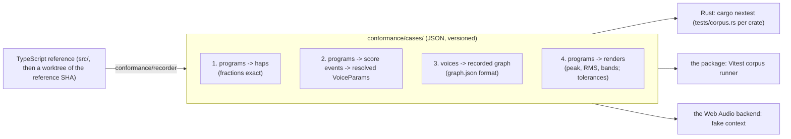

# Conformance: proving the Rust equal to the reference

The TypeScript reference (the merged #39, #42, and #44 on `main`, at `452f782`, the reference SHA) is the specification. The corpus is generated from it, committed, and every implementation is held to it in CI: the Rust crates (`cargo nextest`), the WASM-backed package (Vitest, from RF-27), and the reference itself (`conformance:check`, so the corpus never drifts from the code that made it). **The corpus is the only oracle:** nothing is imported from the lab or the studio. The recorder and its format are built in RF-05 (M1); groups are added in the same change as the Rust that passes them.

## The four layers



| Layer      | Input                                | Output                                                                                 | Compared                  | Rust runner                                                                           |
| ---------- | ------------------------------------ | -------------------------------------------------------------------------------------- | ------------------------- | ------------------------------------------------------------------------------------- |
| 1. Haps    | a program (below), query spans       | haps: `part`, `whole`, `value`, sorted                                                 | byte for byte             | `crates/undertone-pattern/tests/corpus.rs`                                            |
| 2. Voices  | a program, a cycle range, `cps`      | score events and the resolved `VoiceParams` of each, in booking order                  | byte for byte             | `crates/undertone-engine/tests/corpus_voices.rs`                                      |
| 3. Graph   | voices or a score, render options    | the recorded graph (nodes, params, buffers, waves), numbers to nine significant digits | byte for byte             | `crates/undertone-engine/tests/corpus_graph.rs` (extends today's `tests/fixtures.rs`) |
| 4. Renders | a program or a score, render options | per channel: peak, RMS, RMS in eight octave bands, RMS per 100 ms window               | within tolerances (below) | `crates/undertone/tests/corpus_render.rs`                                             |

## Prior art: the earlier fixtures (not imported)

The lab and the studio hold fixtures recorded from the TypeScript by the studio's tools: mini-notation patterns each queried over six spans (or an error with its message and UTF-16 position), and a recorded graph of three renders (`undertone-voices`, `undertone-corners`, `title-theme`). They are **not** copied here and are not an oracle. The corpus built in RF-05 is regenerated from the TypeScript at `452f782`, and these formats are only the model for two of its layers:

- **Layer 1, mini-notation (group `mini`):** patterns with a leaf rule (`word`, `pitch`, `drum`), each queried over six spans (cycles 0 to 4, then 0 to 1, 1 to 2, 2 to 3, 3 to 4, then `1/3` to `7/4`), or an error with its message and UTF-16 position. Fractions are `"n/d"` strings in lowest terms; haps are sorted by `part.begin`, `part.end`, `whole.begin`, `whole.end`, then `value`. The recorder writes them from the reference, including edge and error cases.
- **Layer 3, the recorded graph:** per case, a `score` (events one per line, distinct voices named `v0`, `v1`, ...) and a `graph` (`sampleRate`, `length`, `channels`, `counts`, `nodes` numbered in creation order with `n0` the destination, their non-default fields, `params` as call strings `set <v> @<t>`, `lin`, `exp`, `target <v> @<t> tau <c>`, `cancel @<t>`, `start`, `stop`, and `to` connections; `buffers` with `rms`, `peak`, and the first four samples; `waves` with `real` and `imag`), numbers to nine significant digits. RF-05 writes a recorder that emits this format from `src/test-utils/fakeAudioContext.ts`'s recording. The reference's trigonometry is JavaScriptCore's on Linux, so the engine's maths must match it (R9).
- **A one-off cross-check** against the lab's or the studio's files is allowed outside the repository (for example to learn whether the format reads well), with the outcome noted in a result file. It never becomes a committed fixture, and a difference is a finding about the reference, not a reason to edit a case.
- **Baseline for "options off":** 0.4.0's new options (pan paths, the pan law, the master ceiling, windowed booking) must leave the graph equal to 0.3.0's when off. RF-05 records those baseline cases at `452f782` with the options off, and RF-18 may also cross-check them against a worktree of the `v0.3.0` tag.

## Programs as data

A case's program is JSON, so the same case drives the TypeScript, the Rust, and the package without parsing JavaScript:

```json
{
  "corpus": 1,
  "id": "every-rev-01",
  "group": "combinators",
  "from": "src/pattern.test.ts: every applies on cycle 0",
  "program": [
    ["note", "c4 e4 g4"],
    ["every", 2, [["rev"]]],
    ["gain", "<0.5 1>"]
  ],
  "queries": [[["0/1", "4/1"]], [["1/3", "7/4"]]],
  "haps": "…"
}
```

- A program is a list of steps; the first step is a constructor (`note`, `sound`, `s`, `n`, `chord`, `mini`, `pure`, `silence`, `stack`, `seq`, `cat`, `timecat`, `arrange`, a signal name), and each later step is a method with its arguments. A nested program (`[["rev"]]`) is a pattern argument or a transform given to `every` or `jux`. Arguments are numbers, strings, nested programs, or option objects.
- **Closures are named transforms.** `every(2, p => p.rev())` is `["every", 2, [["rev"]]]`; `fmap` takes a named map (`["fmap", "add", 7]`); `signal(fn)`, `new Pattern(query)`, and arbitrary JavaScript functions are not in the corpus (they are tested by the bridge's own tests).
- **Errors are cases:** a program that throws records `"error": "<message>"`, word for word, with a UTF-16 position when the message has one.
- **Interpreters:** `conformance/recorder/interpret.ts` (against the reference), `crates/undertone-pattern/tests/common/interpret.rs` (against Rust), and `packages/undertone/test/corpus/interpret.ts` (against the package; the same file as the reference's, with a different import).

## Where the programs come from

The merged pull requests already hold most of the corpus, as tests, recipes, and examples. RF-05 and each phase-3 package mine them, and every case names its source in `from`:

- **The reference's tests** (`src/*.test.ts`): every test that builds a pattern and asserts on haps, voices, or a recorded graph becomes one or more cases. The ones to start with for 0.4.0's features: `panPath.test.ts`, `autopan.test.ts`, `panLaw.test.ts`, `masterBus.test.ts`, `render.test.ts` (windowed booking and the ceiling after the fold), `signal.test.ts`, `controlSignals.test.ts` (patternable controls, their equivalence, graph, and sanitising tests), `pattern.test.ts`, `control.test.ts`.
- **The documentation:** every `ts standalone` block that `docSnippets.test.ts` runs (39 on #42), and the examples in `docs/recipes.md` and `docs/guide/*.md` (signals, patterned parameters, stereo and surround, rendering).
- **The playground's examples** (`docs/.vitepress/theme/playground/examples/`: the groups `fullTracks`, `gameSfx`, `movingPan`, `patterns`, `signals`, `songs`, `voices`): each example's pattern, queried over its first four cycles (layers 1 and 2) and recorded (layer 3); the long ones are layer 4 render cases.
- **Generated cases:** for each control, a number, a mini-notation string, and a signal (the equivalence #44 tests: `.pan(0.5)` equals `.pan(pure(0.5))`); edge values (0, negative, beyond range); and the scalar-only controls given a pattern (an error case).

## Groups

Files are `conformance/cases/<layer>/<group>.json`. The first subset (RF-05) is marked with an asterisk.

| Group          | Layer | Cases (target)                                       | Covers                                                                                                                                         | WP    |
| -------------- | ----- | ---------------------------------------------------- | ---------------------------------------------------------------------------------------------------------------------------------------------- | ----- |
| `core`*        | 1     | 40                                                   | `pure`, `silence`, `stack`, `seq`, `cat`, `timecat`, `fast`, `slow`, `euclid`                                                                  | RF-13 |
| `combinators`* | 1     | 60                                                   | `rev`, `every`, `jux`, `arrange`, `fmap` with named maps                                                                                       | RF-13 |
| `mini`         | 1     | about 200                                            | mini-notation with the three leaf rules, six query spans each, and error cases with UTF-16 positions, all recorded from the reference          | RF-13 |
| `notes`*       | 1, 2  | 40                                                   | `note`, `sound`, `s`, `bank`, `n`, `scale`                                                                                                     | RF-15 |
| `chords`       | 1, 2  | 30                                                   | `chord`, `voicing`                                                                                                                             | RF-15 |
| `controls`*    | 2     | 60 (five controls in the subset; all controls later) | every control with number, string, and pattern inputs                                                                                          | RF-14 |
| `signals`*     | 1, 2  | 100                                                  | every signal and shaping method, sampled controls, mixed continuous and discrete compositions, negative time                                   | RF-16 |
| `random`       | 1     | 20                                                   | `seededRandom` (64 values per seed), keyed seeds                                                                                               | RF-17 |
| `drift`        | 2     | 20                                                   | `drift` options                                                                                                                                | RF-17 |
| `placement`*   | 3     | 40                                                   | `panLaw`, `.panlaw`, `ceiling`, `panPath`, `.panpath`, `.panslide`, `.autopan` and its options, `bookingWindow`, and each off (equal to 0.3.0) | RF-18 |
| `voices`       | 3     | 60                                                   | baseline voice booking for the 0.3.0 behaviours (waveforms, envelopes, filters, FM, orbits, master bus), recorded with the new options off     | RF-18 |
| `instruments`  | 2, 3  | 20                                                   | `fmVoice`, presets, `layer`, `.voice`                                                                                                          | RF-19 |
| `channels`     | 3     | 20                                                   | 1, 2, 4, 6, 8 channels, `.surround`, folds                                                                                                     | RF-19 |
| `score`        | 2, 3  | 20                                                   | `score()` with seam, gates, `panLaw`                                                                                                           | RF-20 |
| `wav`          | —     | 10                                                   | `encodeWav` bytes (16, 24, 32 bit, dither seeds) as hex digests and the first 64 bytes                                                         | RF-20 |
| `samples`      | 3     | 10                                                   | sample voices with registered PCM                                                                                                              | RF-21 |
| `renders`      | 4     | 15                                                   | the playground's long examples and scores recorded in the corpus's own format                                                                  | RF-20 |

## Query-window independence and property tests

Property tests run in Rust (`proptest`, in `crates/undertone-pattern/tests/properties.rs` and `crates/undertone-sched/tests/properties.rs`) over random programs (depth at most 5, from the constructors, transforms, and signals above, with mini-notation strings from a small grammar), 10,000 cases in CI and 1,000,000 in a nightly job:

1. **Window independence:** querying `[a, c)` gives the same haps as querying `[a, b)` and `[b, c)` with the fragments of one hap joined (same `whole`, adjacent `part`s, same value), for random `a < b < c` with denominators up to 12.
2. **Inverses:** `p.fast(n).slow(n)` equals `p`; `p.rev().rev()` equals `p`; `p.every(1, f)` equals `f(p)`.
3. **Signals:** a signal sampled at `t` gives the same value in any window that contains `t`; `seed(s)` is reproducible across runs and threads.
4. **Booking:** booking a window gives the same voices as booking its two halves (RF-22).
5. **Round trip:** a tree serialised and rebuilt (for the worklet and worker) queries the same (RF-16).

The same properties 1 to 3 run once against the reference with `fast-check` (a dev dependency; RF-05), to catch a property that the reference itself breaks, which would be a finding for the person rather than a Rust bug.

## Golden renders and tolerances

Layer 4 compares summaries, not samples, because the engines legitimately differ in their last bits (the reference's numbers were made by the TypeScript driving a recording context; the Rust renders with its own DSP).

| Comparison                                                                                                         | Tolerance                                                                                                                                                                                                                                                    | Source                                                                                                             |
| ------------------------------------------------------------------------------------------------------------------ | ------------------------------------------------------------------------------------------------------------------------------------------------------------------------------------------------------------------------------------------------------------ | ------------------------------------------------------------------------------------------------------------------ |
| Rust native against Rust WASM                                                                                      | Within 1e-6 RMS (R9 measured at most 4.0e-16 on the engine's maths). Native uses the C library and WASM the pinned `libm` crate (the `libm` feature), which differ by one unit of the last place in about 3 percent of `sin`, `cos`, `exp`, and `pow` values | R9 ([results/R9.md](results/R9.md))                                                                                |
| Layer 3 against the corpus, engine maths (Rust native on Linux with glibc)                                         | Byte for byte (nine significant digits equal; R9 measured 0 differences against JavaScriptCore)                                                                                                                                                              | R9                                                                                                                 |
| Layer 3 against the corpus, engine maths (WASM, `libm`)                                                            | Nine digits, with an absolute floor of 1e-15 for wave coefficients and gains (R9: 179 of 390 shaped-wave coefficients are numerical zeros of at most 2.4e-16 that differ); everything else byte for byte                                                     | R9                                                                                                                 |
| Rust against a browser render of the reference (an `OfflineAudioContext` in Chromium, recorded once and committed) | RMS within 0.01 dB and peak within 0.02 dB per channel with the master limiter off (measured); per-band RMS within 0.1 dB and per-window RMS within 0.05 dB (proposed, to confirm in RF-20)                                                                  | the studio's measured agreement (`crates/fizz-audio-undertone` `reference.rs` in the Fizz Audio Studio repository) |
| With the limiter on                                                                                                | Peak within 0.1 dB; RMS within 0.05 dB (proposed)                                                                                                                                                                                                            | the limiter's look-ahead differs by design                                                                         |
| Known differences by design                                                                                        | Listed in `conformance/README.md` (band-limited oscillators, the limiter)                                                                                                                                                                                    | —                                                                                                                  |

The browser renders for layer 4 are made by a Playwright script (`conformance/recorder/browser-render.ts`) run by hand on the person's machine (headless Chromium), never in CI, and committed with the browser's version in each case. Nothing in this corpus is a listening test: say so in every result.

## Holding Rust and the package equal in CI

- **Reference:** `bun run conformance:check` regenerates every case in memory from the reference and fails on any difference (until RF-32 against `src/`; after, the job is removed and regeneration is a manual `conformance:record --reference <worktree>`).
- **Rust:** each crate's `tests/corpus*.rs` reads every case of its layers and compares; a failure prints the case id, the program, and the first differing hap or graph line.
- **Package:** `packages/undertone/test/corpus.test.ts` runs layers 1 to 3 through the bridge's public API, so the bridge's wrapping (fractions, values, errors, the Web Audio replay) is held to the same bytes as the Rust.
- **Versioning:** every file carries `"corpus": 1`; a format change bumps it and regenerates everything in the same commit, with the reason in the commit body.
- **Rules for authors:** fixtures are never edited by hand; a behaviour lands with its cases; a case that the reference gets wrong is not "fixed" in the corpus but raised with the person (the reference is the specification until the person says otherwise).
